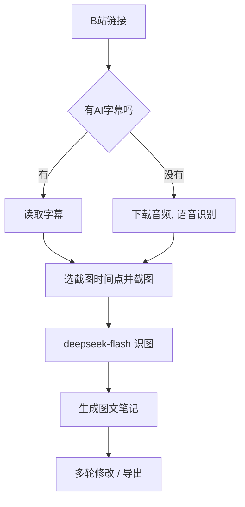

# VideoToNote-Lite

把 B 站网课视频自动整理成图文笔记的安卓 App（自用，适合平板）。

## 功能
- 粘贴 B 站链接，自动生成 Markdown 笔记
- 有 AI 字幕时直接读取字幕；没有字幕时用硅基流动 SenseVoice 做语音转写
- 自动截取 PPT 题目和手写板书，用 deepseek-flash 识图后插入笔记
- 公式用 KaTeX 渲染，支持表格
- 多轮修改：对笔记不满意可以写修改意见，AI 基于已保存的材料重写，不重新截图
- "AI 输入"页面：查看发给 AI 的全部材料
- 导出：图文 MD（图片内嵌）、系统打印另存为 PDF

## 工作流程

## 安装
1. 打开本仓库的 **Releases**，下载最新的 `VideoToNote-Lite.apk`
2. 在平板上安装（签名固定，新版可以直接覆盖安装，设置和笔记都会保留）

## 使用前设置
在 App 的"设置"页填写：
| 设置项 | 说明 |
|---|---|
| DeepSeek API Key | 生成笔记和识图用 |
| 硅基流动 API Key | 没有字幕的视频做语音转写用 |
| 截图笔记 | 默认打开 |
| 保底截图间隔 | 建议 60 秒 |

> Key 只保存在本机，不要写进代码或提交到仓库。

## 文件保存位置
- 笔记：`下载/VideoToNote/`
- 截图：`下载/VideoToNote/img/`

## 已知问题
- "导出 PDF"按钮在部分设备上会卡住，可以先用"系统打印 → 另存为 PDF"代替
- 暂不支持导出 DOCX（公式支持不成熟）

## 编译
用 GitHub Actions 自动编译，配置文件在 `.github/workflows/build.yml`。
修改后提交，Actions 显示绿色对勾后到 Releases 下载 APK。

## 版本历史
| 版本 | 内容 |
|---|---|
| 1.3 | 截图识图、无字幕语音转写 |
| 1.4 | KaTeX 公式、AI 输入页、多轮修改 |
| 1.4.1 | 表格显示、公式补救、修改意见完整显示 |
| 1.5 | 导出 PDF / 图文 MD / 系统打印 |
| 1.5.1 | 修复系统打印 |
| 1.5.2 | 导出 PDF 加入诊断和自动改用系统打印 |
